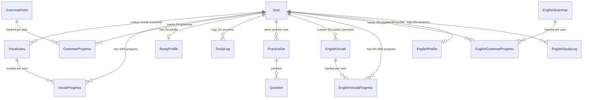

# Thiết kế Cơ sở Dữ liệu Đa Người Dùng (Multi-User Architecture)

Hệ thống tách biệt rõ **Kho học liệu dùng chung (Shared Curriculum Catalog)** và **Tiến độ / Dữ liệu cá nhân theo từng User (`userId`)**, giúp nhiều người cùng học trên một hệ thống mà không xung đột dữ liệu, đồng thời tiết kiệm lưu trữ khi không phải nhân bản hàng nghìn từ vựng cho mỗi tài khoản.

---

## 1. Sơ đồ quan hệ (ERD)

---

## 2. Phân tách các nhóm bảng

### A. Tài khoản (`User`)
- `User`: `id (UUID PK)`, `username (UNIQUE)`, `email (UNIQUE, nullable)`, `passwordHash`, `displayName`, `role (USER | ADMIN)`, `createdAt`, `updatedAt`.
- Xác thực qua JWT Bearer Token (`AuthModule` + `JwtAuthGuard`), mật khẩu hash bằng `bcryptjs`.

### B. Kho Học liệu Dùng chung vs Từ Cá nhân
- **`Vocabulary` (Tiếng Trung HSK 1→3)** & **`EnglishVocab` (Tiếng Anh A1→B2)**:
  - `ownerId (nullable FK -> User.id)` + `scopeKey (String)`:
    - Khi `ownerId = NULL` và `scopeKey = 'GLOBAL'`: là từ vựng thuộc kho giáo trình chuẩn dùng chung cho mọi người học (2.270+ từ HSK 1–3, 2.750+ từ Oxford A1–B2).
    - Khi `ownerId = user.id` và `scopeKey = user.id`: là từ vựng cá nhân do user tự thêm/AI mở rộng; chỉ user đó nhìn thấy, sửa và xóa.
  - Unique constraint `@@unique([scopeKey, word, partOfSpeech])` (Trung) và `@@unique([scopeKey, word])` (Anh) đảm bảo PostgreSQL không bị bug `NULL != NULL` trên unique index.
- **`GrammarPoint`** (HSK 1–3) & **`EnglishGrammar`** (A1–B2):
  - Chỉ lưu nội dung ngữ pháp chuẩn dùng chung, không chứa trạng thái học tập của riêng ai.

### C. Bảng Tiến độ Riêng theo Từng Người Học (`userId`)
Mọi trạng thái học tập đều gắn `userId` và có `@@unique([userId, <targetId>])`:
1. **`VocabProgress`**: `(userId, vocabularyId)` lưu `status`, `srsLevel`, `intervalDays`, `easeFactor`, `nextReviewAt`, `lastReviewedAt`, `reviewCount`, `correctCount`, `wrongCount`, `aiMnemonic`, `aiExamples`, `lastMistakeNote`.
2. **`GrammarProgress`**: `(userId, grammarPointId)` lưu `status`, `practiceCount`, `lastPracticedAt`.
3. **`StudyProfile`**: `userId (UNIQUE)`, `currentLevel (HSK1 | HSK2 | HSK3)`, `dailyMinutesTarget`, `newWordsPerDay`, `reviewWordsPerDay`, `grammarPerDay`, `preferredModel`, `currentDayNumber`.
4. **`StudyLog`**: `(userId, date, dayNumber, level, minutesSpent, newWordsLearned, wordsReviewed, grammarPracticed, score, aiCoachingFeedback)`.
5. **`PracticeSet` & `Question`**: `PracticeSet.userId` cô lập hoàn toàn các bộ đề luyện viết tay của mỗi người.
6. **`EnglishVocabProgress`**: `(userId, englishVocabId)` lưu toàn bộ SRS + `aiDeepDive` + `lastMistakeNote` cho tiếng Anh.
7. **`EnglishGrammarProgress`**: `(userId, englishGrammarId)` lưu trạng thái thành thạo ngữ pháp tiếng Anh riêng.
8. **`EnglishProfile`** & **`EnglishStudyLog`**: Lưu kết quả test đầu vào (`placementDone`, `placementScore`, `currentLevel A1..B2`), số ngày học và nhật ký học tập riêng từng người.

---

## 3. Chiến lược Truy vấn Tiến độ (`new` mặc định)
- Khi user mới đăng ký, hệ thống **không cần tạo trước 5.000 dòng progress**.
- Các từ chưa có bản ghi trong `VocabProgress` / `EnglishVocabProgress` của `userId` đó mặc định được coi là trạng thái `new`.
- Chỉ khi user bắt đầu ôn/học từ hoặc xem Deep Dive AI, bản ghi mới được `upsert` vào bảng progress theo `(userId, vocabId)`.
